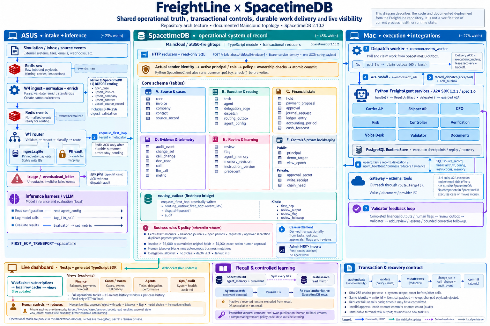

# FreightLine: Autonomous Back Office for Freight Brokerages

FreightLine runs the finance back office of a mid-size freight brokerage, from delivery paperwork to
carrier settlement and shipper collections. Nine specialist agents run as independent A2A services,
coordinate through SpacetimeDB, and act on messy source records: carrier invoices, PODs, rate
confirmations, emails, remittances and BAI2 bank files. Money never moves on a model's say-so. Every
financial change passes deterministic controls in code and lands in an append-only, Git-style audit trail.

Built for the Hyphenate (autonomous finance) track at Cal Hacks 13.0.



## The agents

| Agent | Service | Port | Skills | May delegate to |
|---|---|---|---|---|
| Carrier Settlement | `carrier_ap` | 9101 | process carrier invoice, propose payment, answer payment status | Accessorial Audit, Settlement Approvals, Verification, Documents |
| Shipper Billing & Collections | `shipper_ar` | 9102 | reconcile customer payment, chase overdue, set credit limit | Settlement Approvals, Verification, Outreach, Load Profitability, Documents |
| Load Profitability | `cfo` | 9103 | assess financial impact, cash forecast | Collections, Carrier Settlement, Settlement Approvals |
| Accessorial Audit | `risk` | 9104 | investigate charge, screen bank change, screen counterparty | Verification, Settlement Approvals, Documents |
| Settlement Approvals | `controller` | 9105 | review hold, check already paid, reconcile, approve entry | Load Profitability, Verification, Outreach, Documents |
| Carrier Trust & Verification | `verification` | 9106 | verify claim, verify bank change, verify dispute | Outreach |
| Dispatcher Outreach | `voice_desk` | 9107 | place call, handle inbound call | none |
| Settlement Quality Review | `validator` | 9108 | review output, review flag | none |
| POD & Document Chase | `documents` | 9109 | collect documents, check document packet, receive document | Outreach |

The registry lives in `common/config.py`. Delegation is bounded in code: depth at most 3, no cycles,
allowlisted targets only. Each case invokes only the specialists it needs.

Settlement Quality Review checks other agents' work and files lessons when a check fails. Lessons about
procedure are filed skill-wide, so later loads recall them. Lessons about one counterparty's records
stay scoped to that counterparty. Resolved cases and lessons are mirrored to an Elastic index for
similarity recall. SpacetimeDB stays the system of record, and recall is advisory only.

## How work flows

1. **Simulator** (`sim/`) generates a synthetic brokerage over real counterparties: FMCSA carriers and
   SEC EDGAR shippers. It writes PDFs, `.eml` messages and BAI2 bank records, plus an answer key of
   planted errors.
2. **Ingest** (`ingest/`) reads raw arrivals from Redis, extracts and matches documents, and mirrors
   source records into SpacetimeDB.
3. **Router** (`router/`, on the ASUS box) does intake classification and first-hop routing only. It
   enqueues each case into the SpacetimeDB `routing_outbox`.
4. **Dispatch worker** (`common/review_worker.py`) claims outbox rows and delivers them to agents over A2A.
5. **Agents** (`agents/<role>/`) call models and scoped tools, delegate to each other, and propose actions.
   Agent execution checkpoints live in PostgreSQL.
6. **Controls**: state changes go through `common/policy.py` and SpacetimeDB reducers, which enforce limits,
   holds and approvals in the same transaction that changes the data.
7. **Evaluator** (`evaluator/`) scores agent decisions against the answer key: precision, recall, dollars
   caught, false holds, median resolution time and calls placed.

| Store | Role |
|---|---|
| SpacetimeDB (Maincloud `at350-freightops`) | Operational truth: cases, tasks, ledger, holds, approvals, payment proposals, source records, memory, audit |
| PostgreSQL | Agent execution: snapshots, leases, steps, callbacks |
| Redis | Raw and normalized intake streams |
| SQLite (`data/ingest.db`) | Ingest's transactional state |
| Elastic | Derived recall index of memory and precedents |

The full write-up, with sequence diagrams, is in
[output/spacetime-architecture/README.md](output/spacetime-architecture/README.md) and
[docs/architecture/](docs/architecture/spacetimedb-architecture-notes.md).

## Dashboard

`make web` serves the Next.js dashboard on http://localhost:3001. It reads live from SpacetimeDB.

| Page | What it shows |
|---|---|
| **Finance** `/` | Home: cash, monthly cash flow, the attention queue and pending approvals. The work queue has a one-click Clear with Undo. |
| **Invoices** `/invoices` | Carrier and shipper invoices with status, in a scrolling table |
| **Ledger** `/ledger` | Journal entries (who requested and who posted each), a trial balance that must net to zero, AR/AP subledger tie-outs, and the GL spreadsheet with blame, diff and history |
| **Operations** `/operations` | Operational status strip and what each agent on the crew is working on |
| **Agents** `/agents` | The live agent map, with activity pills and per-agent panels |
| **Cases** `/cases` | Case explorer and execution trace for each case, from source document to resolution |
| **Demo** `/demo` | Demo Console: start fresh, run scenario presets (detention charge, bank change, short payment, shipper underpays) or describe your own, and place the demo phone call |

A Log overlay on every page holds the decision log. The old `/ops` admin console now redirects to `/`.

## Layout

| Path | What |
|---|---|
| `agents/<role>/` | One A2A service per agent: `card.py`, `instructions.md`, `knowledge/`, `tools.py`, `main.py` |
| `common/` | Shared contracts (`envelope.py`), A2A runtime, policy engine, outreach guard, SpacetimeDB client, recall, dispatch worker |
| `spacetime/` | SpacetimeDB module (reducers and schema) and its docs |
| `web/` | Next.js dashboard |
| `harness/` | ASUS intake harness and model telemetry |
| `router/` | Redis consumer, first-hop routing |
| `gateway/` | Cartesia call polling, in-call tools, demo endpoints |
| `sim/` `ingest/` | Synthetic brokerage and ingestion |
| `integrations/` | Bounded Apify adapters. CRS, Nessie and email scaffolds are deferred. |
| `evaluator/` | Answer-key scoring |
| `scripts/` | Launchers, SpacetimeDB admin, history seeding, live checks |
| `docs/` | Runbooks, handoff, architecture, PRD |
| `output/` | Brand assets, rendered demo documents, architecture renders |
| `sites/ledger-orbit/` | Standalone static concept site |

## Quick start (local, no credentials)

Requires Python 3.12, Node, Docker and the `spacetime` CLI.

```bash
cp .env.example .env
make setup && make infra   # venv, npm install, Postgres + Redis
make agents                # nine services on :9101-9109
make demo                  # fixture case across the real A2A mesh
make test                  # Python tests
```

The fixture run proves the A2A mesh and controls. It does not prove live integrations. Model, call and
external-data results are simulated until live mode is configured.

For a local SpacetimeDB and the dashboard:

```bash
make spacetime-start                        # separate terminal, :3000
make spacetime-publish spacetime-generate
make spacetime-demo                         # optional labeled demo data
make seed-history                           # optional ~90 days of resolved history
make web                                    # :3001
```

See [spacetime/README.md](spacetime/README.md), the [integration guide](spacetime/INTEGRATION.md) and the
[reducer contracts](spacetime/module/CONTRACT.md).

## Running the team stack (Maincloud)

The demo spans two machines. Both reach Maincloud outbound, and neither needs to reach the other.

| Machine | Runs |
|---|---|
| ASUS | Redis, `make sim`, `make ingest`, `make router`, vLLM behind the harness |
| Mac | PostgreSQL, `make live-agents`, the dispatch worker, `make live-gateway`, the recall sync, `make web` |

On the Mac, once the private `services.env` profile is in place:

```bash
make live-agents     # :9101-9109
make live-gateway    # :9000
.venv/bin/python -u -c "from scripts.local_env import load_live_env; load_live_env(); \
import runpy; runpy.run_module('common.review_worker', run_name='__main__')"
make web
```

[docs/TEAM-CLOUD-HANDOFF.md](docs/TEAM-CLOUD-HANDOFF.md) covers profiles, credential files, environment
layering and the republish order. `make cloud-verify` runs a read-only cutover checklist.

### Environment files

Service targets (`agents`, `gateway`, `router`, `ingest`, `sim`, `world`, `source`, `harness`,
`review-worker`, `evaluator`) load `.env` themselves. Choose another profile with
`ENV_FILE=path/to/file.env`. Variables already in your shell win. The live launchers (`live-agents`,
`live-gateway`) instead layer `.env`, then `data/w2/<SPACETIME_DB>/services.env`, then
`data/live/runtime.env`, each overriding the shell.

`make test`, `make lint` and `make demo` never load `.env`, so a live profile cannot reach the test
suite. Don't `source` a live `.env` into the shell you run tests from.

### Ports

Gateway 9000 · Voice tools 9001 · Harness 8000 · Agents 9101-9109 · SpacetimeDB (local) 3000 · Web 3001

Override an agent's address with `AGENT_URL_<NAME>`, or its bind port with `AGENT_PORT_<NAME>`.

## Sponsor integrations

**Apify** supplies public carrier lookups and company website inspection. Actor runs are durable,
results are cached for 24 hours, and pending runs are polled rather than resubmitted. Public contacts
are unverified observations and can never authorize outreach, bank changes or payment.

**Cartesia** supplies voice: three hosted personas (verification, collections, approvals) and an
outbound number. The gateway polls for call completion locally, so no public webhook is required.
Calls go only to an allowlisted team destination and a verified case contact. Ordinary calls also
need an open calling window and are limited to one attempt per company per hour.

The Demo Console's **Call my phone** button starts a durable Verification → Dispatcher Outreach
workflow for the prepared GG-1042 case. GG-1042 is a fictional Oakland-Sacramento dry-van load with a
$250 detention claim. During the call, voice can look up the load, documents, case summary, invoice
and payment status through a read-only tool service on :9001. To enable the button, set
`DEMO_PHONE_ENABLED=1` and a private `DEMO_CONTROL_TOKEN` in the gateway profile and in
`web/.env.local`, along with `GATEWAY_URL=http://127.0.0.1:9000`. Never put the token in a
`NEXT_PUBLIC_*` variable.

```bash
.venv/bin/python -m scripts.setup_cartesia                 # read-only account check
.venv/bin/python -m scripts.live_sponsors check-voice      # readiness, no call
.venv/bin/python -m scripts.live_sponsors lookups --run-id <id>   # may spend Apify/model credits
```

Details: the [voice demo guide](docs/VOICE-DEMO.md), plus the
[phone call](docs/A2A-RUNBOOK.md#enable-a-real-demo-phone-call) and
[Apify](docs/A2A-RUNBOOK.md#use-real-apify-evidence) sections of the runbook.

## Simulator, ingest and evaluator

`make sim` backfills completed history, warm-starts in-flight loads, and then starts a new load about
every 8 seconds. It publishes arrival metadata, not extracted answers, to Redis `raw`, and appends to
`data/events.jsonl`. `make ingest` combines raw files with the structured TMS feed and publishes
routable case events to `events`. It sends extracted documents to `documents`, which goes to audit and
review but never to the router. It also keeps the agents' source dataset current. Brokerage records
are marked `"synthetic": true`. Companies and contacts carry their FMCSA/SEC provenance. `make world`
refreshes that directory.

Ingest treats an unmatched deposit the way a collections clerk would. It looks for the one open
invoice from the remitter with exactly that balance. A match is routed with `reference_mismatch: true`
for Shipper Billing & Collections to review, and is never applied as cash. No match, or more than one,
is left as a `needs_review` deposit.

`make evaluator` joins `answer_key.jsonl` to agent decisions in SpacetimeDB and writes the scoreboard to
the `metric` table. It runs where the simulator runs, because that is where the answer key lives.
`python -m evaluator.main --once --dry-run` prints the scoreboard without writing.

For a Redis-free dataset and formal checks:

```bash
.venv/bin/python -m sim.generator --offline --loads 40 --data /tmp/w4-data
make verify-data SIM_DATA_DIR=/tmp/w4-data
```

Stream names, caps and retention are configurable (`RAW_STREAM`, `EVENTS_STREAM`, `DOCUMENTS_STREAM`,
`*_STREAM_MAXLEN`, `SIM_DATA_MAX_MB`, `SIM_KEEP_LOADS`). See `.env.example`.

## Testing

```bash
make lint test                 # ruff + pytest
cd web && npm test             # frontend unit tests
make w2-check                  # everything, including the module tests and a production web build
make spacetime-test            # real reducers against a fresh local database
```

## Rules

- Money and ledger changes go through `common/policy.py` and SpacetimeDB reducers, never through the LLM.
- `OUTREACH_MODE=demo` routes every call and email to `DEMO_ALLOWLIST_*`. The real contact is shown as `intended_to`.
- All outreach goes through `common.outreach.route_target()`, and all delegation through `FreightAgent.delegate()`.
- Contracts in `common/envelope.py` change only with agreement from the owners on both sides.
- Never commit `.env` or keys. Private notes stay under the ignored `docs/private/`.
- The GG-1042 hero case is one regression fixture. Real workflows use each case's own records and evidence.
- Fixture and provider tests do not establish live integration. That takes configured credentials and separate acceptance checks.

More notes for coding agents are in [AGENTS.md](AGENTS.md). [docs/PRD.md](docs/PRD.md) is the original
spec. It is out of date, so treat `main` and the runbooks as current.
