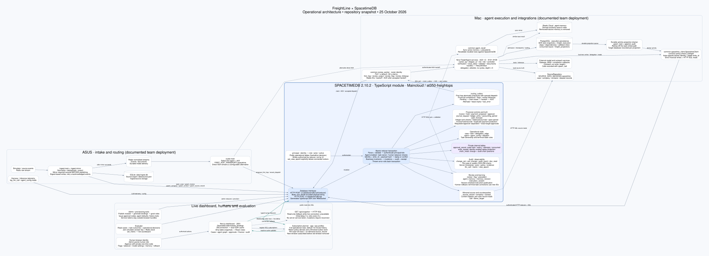
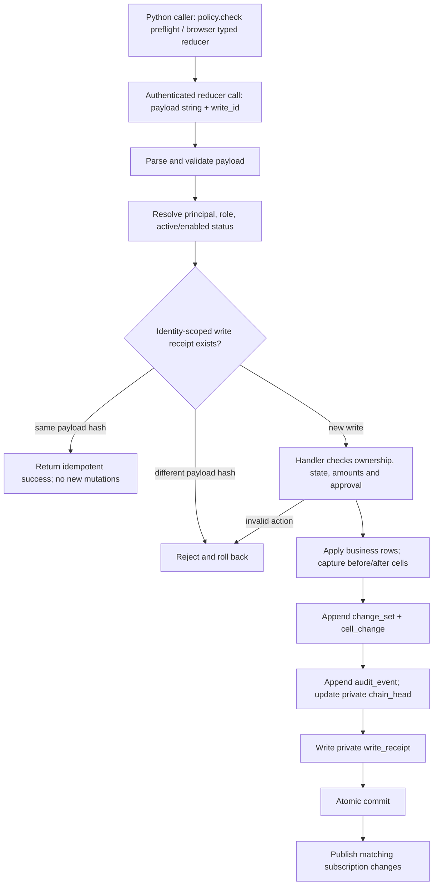
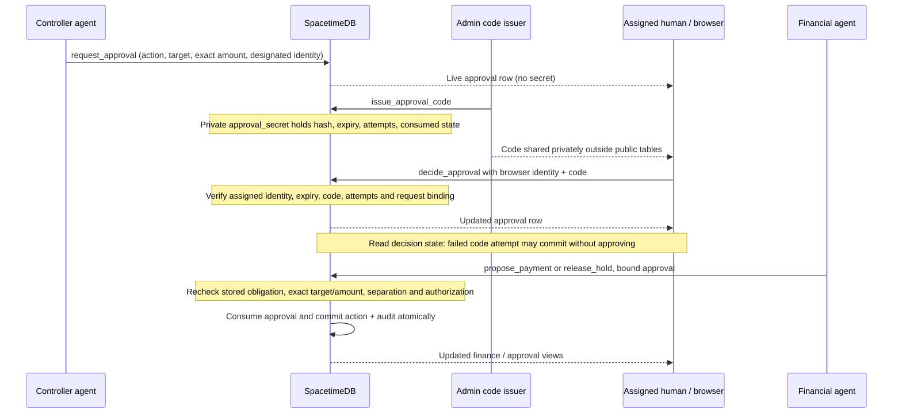
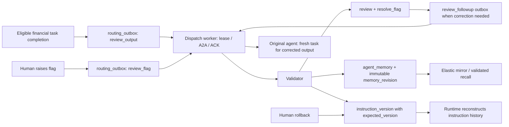

# FreightLine: SpacetimeDB architecture

Repository-derived snapshot, 25 October 2026. This documents implemented code and the documented team deployment; it does not assert that every process is currently running or that the cloud schema matches this checkout.

[Zoomable SVG](architecture.svg) · [PNG](architecture.png) · [Editable Graphviz source](architecture.dot)



## Storage and execution boundaries

- **SpacetimeDB** is operational truth: cases, business task projections, financial decisions, source records, delivery work, review history and audit. Reducers enforce invariants in the transaction that changes the data.
- **PostgreSQL** persists agent execution: SDK snapshots, admission, leases, steps, dependency joins, callback inbox and a durable activity projection queue. SpacetimeDB's `task` is the shared operational projection, not the worker scheduler.
- **Redis** carries incoming raw and normalized events. **SQLite** persists ingest records; `source.json` remains the file-backed source alternative. The team cloud configuration uses SpacetimeDB source records so agents do not need a copied export.
- **Elastic** is a derived recall index of active memory and precedents. SpacetimeDB remains authoritative; recall checks source rows and sync removes stale entries.
- **Agent processes** execute models, tools and A2A delegation. Reducers do not execute LLMs or outbound calls. A `payment_proposal` is a proposal, not evidence of a bank transfer.

The documented deployment places intake, Redis and routing on ASUS; PostgreSQL, agents, dispatch worker, gateway, recall sync and dashboard on the Mac; and SpacetimeDB on Maincloud (`at350-freightops`). Addresses remain independently configurable. Local development uses SpacetimeDB on port 3000 and the dashboard on 3001.

## Intake, cross-machine delivery and execution

```mermaid
sequenceDiagram
    participant I as ASUS ingest
    participant S as SpacetimeDB
    participant R as Redis normalized events
    participant Q as ASUS router
    participant W as Mac dispatch worker
    participant A as FreightAgent / A2A
    participant P as PostgreSQL
    participant U as Browser
    I->>S: Mirror case, invoice, directory, source records
    Note over I,S: Content hashes / stable write IDs; mirror failure leaves raw entry unacknowledged
    I->>R: Publish normalized event after required mirror succeeds
    R->>Q: Consume routable event
    Q->>S: enqueue_first_hop
    Note over S: Commit routing_outbox + queued dispatch together
    W->>S: Poll pending work; claim_outbox (60 s lease)
    W->>A: Authenticated A2A, stable event idempotency key
    A->>P: Persist admission and execution
    A-->>W: Accepted task
    W->>S: Record accepted dispatch, then ack_outbox
    A->>S: Source/config/memory SQL reads; strict business reducers
    A->>P: Persist task/tool projections
    P-->>A: Activity drainer reads durable projection queue
    A->>S: upsert_task / append_audit with stable write IDs
    S-->>U: WebSocket subscribed-row deltas
```

The default router transport in code is direct A2A; the team handoff explicitly sets `FIRST_HOP_TRANSPORT=spacetime`. The graph labels both paths. Outbox polling defaults to one second. Delivery failure uses bounded backoff; expired leases allow recovery. A delivered/ACKed row means successful handoff, not completed business work. The PostgreSQL projection queue and SpacetimeDB routing outbox serve different directions and are not one queue.

## Mutation, authorization and audit transaction



Every exported reducer uses `execute()`: role checks and replay detection precede the handler. Most changed writes generate a change set, cell deltas, audit event and receipt atomically; handlers marked unchanged write only a receipt. Change sets hash canonical data including changed cells, actor and parent hash. Audit events have a separate chain. Both are scoped to a case, or to the system when no case applies. Thrown failures roll everything back; sanitized refusals are logged server-side, so a failed transaction cannot preserve its own audit insertion.

Financial controls validate dollar inputs to exact cents and use integer arithmetic for checks. They enforce balanced journal lines, open accounting periods, stored invoice bounds, duplicate-payment prevention and requester/approver separation. Human-owned cases restrict autonomous financial mutation. Terminal tasks cannot be reopened; corrections need a new task.

Transport timeout does not prove rollback. Stable write IDs support reconciliation/retry, but an already-consumed authorization can cause strict client preflight to reject a replay: read stored state before repeating a financial action.

## Human approval and financial action



Originally over-$5,000 invoices and holds require authorization even when a proposed payment or release is a smaller partial amount. Public `code_ok` is not an authorization input. Admin issues codes; the assigned human decides. Infrastructure admin is not a universal agent impersonation role.

## Validation and learning feedback



Instruction rows are patches; the runtime reconstructs history, including `reverts_version`, rather than treating the active row as a complete prompt. Automated publication is version-checked and policy-constrained. Human rollback creates another historical version.

## Dashboard read path and fallback

The browser connects directly with the generated TypeScript SDK. It obtains its own identity/token, stores the token locally, subscribes to SQL queries and reads the SDK's local cache. Dirty-table snapshot rebuilding preserves unaffected row/array identity before React selectors and views update.

- Full subscriptions retain operational aggregates such as cases, tasks, invoices, holds and approvals.
- Audit/document history uses a default 15-minute window. Policy-denial audit events remain included regardless of age.
- `/ops` additionally includes change sets, cell deltas, outbox and LLM telemetry; unfinished outbox rows survive the time cutoff. The main app excludes ops-only tables.
- Case pages add their full historical trace and subscribe to case-specific source records on demand.
- Window rotation subscribes to the replacement before removing the previous subscription.
- `view_epoch` changes the shared visible activity boundary; it is not a data deletion.
- When live setup is unavailable, `/api/snapshot` provides read-only HTTP SQL snapshots after a 4-second initial delay, retried every 5 seconds while not ready. It uses no server service token. Mutations require a live connection; source-record watching is unavailable in fallback mode.

Operational tables are public in this hackathon schema, including synthetic source records and principal metadata. `approval_secret`, `write_receipt` and `chain_head` are private. Most writes require a provisioned role; `set_view_epoch` explicitly accepts any active connected identity, including an unprovisioned visitor.

## Source map

- `spacetime/module/spacetimedb/src/schema.ts`: canonical schema and table visibility.
- `spacetime/module/spacetimedb/src/index.ts`: exported reducers and role allowlists.
- `spacetime/module/spacetimedb/src/operations.ts`: transaction wrapper, audit, business controls and outbox creation.
- `spacetime/module/spacetimedb/src/policy.ts`: cents arithmetic, payload checks, delegation/state constraints.
- `common/spacetime_client.py`: strict Python preflight, HTTP protocol, SQL and error semantics.
- `ingest/main.py`, `ingest/mirror.py`: source mirroring before event publication.
- `router/main.py`, `common/review_worker.py`: configurable first-hop transport and durable delivery.
- `common/runtime.py`, `common/runtime_store.py`: execution persistence and activity projections.
- `common/source_repository.py`, `common/agent_recall.py`: source reads and derived recall index.
- `web/components/live-provider.tsx`, `web/lib/live-queries.ts`, `web/app/api/snapshot/route.ts`: live subscriptions and fallback.
- `evaluator/main.py`: outcome scoring and metric publication.
- `docs/TEAM-CLOUD-HANDOFF.md`, `spacetime/CLOUD.md`: deployment configuration.

The following inventories are extracted directly from the schema and reducer registrations in this checkout.

## Complete table inventory (37 tables)

| Table | Visibility | Columns (canonical SQL names) |
|---|---|---|
| `case` | Public | `case_id`, `load_id`, `opened_at`, `status`, `priority`, `title`, `exposure_usd`, `resolved_at` |
| `task` | Public | `task_id`, `case_id`, `parent_task_id`, `agent`, `skill`, `display_id`, `a2a_state`, `business_status`, `outcome`, `confidence`, `model_used`, `started_at`, `updated_at`, `evidence_refs`, `artifact_json`, `policy_ids`, `instr_version`, `memory_ids`, `depth` |
| `agent` | Public | `name`, `status`, `active`, `queued`, `done`, `errors`, `p50_ms`, `card_url`, `last_seen` |
| `agent_config` | Public | `agent`, `model`, `enabled` |
| `ledger_entry` | Public | `id`, `case_id`, `period`, `lines`, `memo`, `requested_by`, `approved_by`, `posted_at`, `request_id`, `requester_identity`, `approver_identity` |
| `hold` | Public | `id`, `case_id`, `invoice_id`, `amount`, `reason_code`, `status`, `placed_by`, `released_by`, `released_amount`, `placed_at`, `released_at` |
| `payment_proposal` | Public | `id`, `case_id`, `carrier_id`, `invoice_id`, `load_id`, `amount`, `status`, `proposed_by`, `proposed_at`, `approval_id` |
| `approval` | Public | `id`, `case_id`, `task_id`, `action`, `target_id`, `amount`, `requested_by`, `requester_identity`, `approver`, `approver_name`, `decision`, `code_ok`, `decided_at`, `expires_at`, `consumed_at`, `code_issued`, `failed_attempts`, `last_error`, `invoice_id` |
| `audit_event` | Public | `id`, `ts`, `case_id`, `task_id`, `agent`, `kind`, `reason_code`, `summary`, `evidence_refs`, `policy_ids`, `model_used`, `prev_hash`, `hash`, `sequence`, `hash_body`, `change_set_id`, `actor_identity` |
| `call` | Public | `id`, `case_id`, `task_id`, `persona`, `direction`, `to_masked`, `intended_to`, `routed_to`, `company_id`, `contact_id`, `status`, `started_at`, `ended_at`, `findings_json`, `transcript_redacted`, `recording_url`, `disclosure_given` |
| `precedent` | Public | `id`, `carrier_id`, `claim_type`, `lane`, `pattern_json`, `outcome`, `as_of`, `source_case` |
| `llm_call` | Public | `id`, `ts`, `agent`, `model`, `latency_ms`, `tokens`, `route_reason`, `ensemble_agreement` |
| `dispatch` | Public | `event_id`, `case_id`, `skill`, `agent`, `task_id`, `status`, `reason`, `queue_ms`, `policy_version`, `ts` |
| `metric` | Public | `name`, `value`, `updated_at` |
| `change_set` | Public | `id`, `parent_id`, `case_id`, `task_id`, `agent`, `action`, `summary`, `policy_ids`, `instr_version`, `memory_ids`, `ts`, `hash`, `parent_hash`, `sequence`, `hash_body`, `actor_identity`, `write_id` |
| `cell_change` | Public | `id`, `change_set_id`, `sheet`, `row_key`, `column`, `before`, `after` |
| `doc_read` | Public | `id`, `change_set_id`, `task_id`, `agent`, `doc_ref`, `page`, `span`, `extracted_json` |
| `review` | Public | `id`, `target_task_id`, `case_id`, `verdict`, `checks_json`, `friction_json`, `ts`, `actions_json` |
| `agent_memory` | Public | `id`, `agent`, `scope`, `text`, `source`, `source_ref`, `version`, `active`, `created_at` |
| `instruction_version` | Public | `id`, `agent`, `version`, `diff`, `reason`, `author`, `source_ref`, `created_at`, `active`, `reverts_version` |
| `flag` | Public | `id`, `target_ref`, `case_id`, `kind`, `note`, `raised_by`, `status`, `resolution_ref`, `ts` |
| `company` | Public | `id`, `kind`, `name`, `usdot`, `mc`, `phone`, `website`, `source_url` |
| `contact` | Public | `id`, `company_id`, `name`, `title`, `phone`, `email`, `linkedin_url`, `source`, `source_url`, `confidence`, `alternates_json` |
| `delegation_edge` | Public | `id`, `ts`, `case_id`, `from_agent`, `to_agent`, `skill`, `task_id`, `parent_task_id`, `depth` |
| `invoice` | Public | `id`, `case_id`, `carrier_id`, `load_id`, `amount`, `contract_amount`, `paid_amount`, `issued_at`, `status` |
| `accounting_period` | Public | `period`, `status`, `updated_at` |
| `principal` | Public | `identity`, `role`, `actor`, `active`, `granted_at` |
| `cash_forecast` | Public | `id`, `case_id`, `period`, `category`, `amount`, `confidence`, `assumptions_json`, `updated_at` |
| `journal_request` | Public | `id`, `case_id`, `period`, `lines`, `memo`, `requested_by`, `requester_identity`, `created_at`, `posted_entry_id` |
| `routing_outbox` | Public | `id`, `kind`, `target_agent`, `case_id`, `task_id`, `payload_json`, `status`, `attempts`, `created_at`, `updated_at`, `claimed_by`, `lease_expires_at`, `last_error` |
| `memory_revision` | Public | `id`, `memory_id`, `agent`, `version`, `scope`, `text`, `source`, `source_ref`, `active`, `created_at` |
| `demo_target` | Public | `phone`, `label`, `enabled` |
| `source_record` | Public | `id`, `kind`, `case_id`, `record_json`, `digest`, `updated_at` |
| `view_epoch` | Public | `id`, `since`, `set_by`, `set_at` |
| `approval_secret` | Private | `approval_id`, `code_hash`, `expires_micros`, `attempts`, `consumed` |
| `write_receipt` | Private | `id`, `payload_hash`, `action`, `actor_identity`, `change_set_id`, `ts` |
| `chain_head` | Private | `name`, `id`, `hash`, `sequence` |

## Complete reducer inventory (43 reducers)

`AGENTS` = carrier_ap, shipper_ar, cfo, risk, controller, verification, voice_desk, validator, documents. `ANYONE` is the explicit connected-identity exception. `init` is a separate module lifecycle hook.

| Reducer | Allowed role(s) | Handler |
|---|---|---|
| `grant_role` | [admin] | `grantRole` |
| `open_case` | [ingest] | `openCase` |
| `update_case` | [controller, validator, human] | `updateCase` |
| `upsert_invoice` | [ingest] | `upsertInvoice` |
| `set_period` | [admin, human] | `setPeriod` |
| `request_journal_entry` | [carrier_ap, shipper_ar, cfo, controller] | `requestJournalEntry` |
| `post_journal_entry` | [controller] | `postJournalEntry` |
| `place_hold` | [controller] | `placeHold` |
| `release_hold` | [controller] | `releaseHold` |
| `propose_payment` | [carrier_ap] | `proposePayment` |
| `request_approval` | [controller] | `requestApproval` |
| `issue_approval_code` | [admin] | `issueApprovalCode` |
| `decide_approval` | [human] | `decideApproval` |
| `upsert_task` | AGENTS | `upsertTask` |
| `record_delegation` | AGENTS | `recordDelegation` |
| `agent_heartbeat` | AGENTS | `agentHeartbeat` |
| `append_audit` | AGENTS | `appendAudit` |
| `record_doc_read` | AGENTS | `recordDocRead` |
| `set_demo_target` | [admin] | `setDemoTarget` |
| `upsert_company` | [ingest] | `upsertCompany` |
| `upsert_contact` | [ingest] | `upsertContact` |
| `upsert_call` | [voice_desk] | `upsertCall` |
| `add_precedent` | [controller] | `addPrecedent` |
| `log_llm_call` | [harness] | `logLlmCall` |
| `record_dispatch` | [router] | `recordDispatch` |
| `set_metric` | [evaluator] | `setMetric` |
| `set_agent_model` | [human] | `setAgentModel` |
| `upsert_forecast` | [cfo] | `upsertForecast` |
| `add_review` | [validator] | `addReview` |
| `upsert_memory` | [validator, human] | `upsertMemory` |
| `publish_instruction_version` | [validator, human] | `publishInstruction` |
| `revert_instruction_version` | [human] | `revertInstruction` |
| `raise_flag` | [human] | `raiseFlag` |
| `resolve_flag` | [validator] | `resolveFlag` |
| `claim_outbox` | [router] | `claimOutbox` |
| `ack_outbox` | [router] | `ackOutbox` |
| `enqueue_first_hop` | [router] | `enqueueFirstHop` |
| `upsert_source_record` | [ingest] | `upsertSourceRecord` |
| `ensure_agent_defaults` | [admin] | `ensureAgentDefaults` |
| `set_view_epoch` | op.ANYONE | `setViewEpoch` |
| `settle_cases` | [admin] | `settleCases` |
| `import_history_batch` | [admin] | `importHistoryBatch` |
| `remove_imported_history` | [admin] | `removeImportedHistory` |
